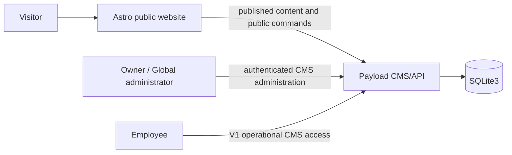

# V2 Architecture Contract — Il Forno Nero

> External project Architecture Contract proposal, prepared 8 November 2026. Status: `READY_FOR_OWNER_ARCHITECTURE_APPROVAL`. It is GitHub-published project evidence, not a canonical BMSF artifact. It does not authorize V2 Development until the Product Owner approves this exact version.

## Status and pinned baseline

- **Architecture proposal:** `PASS` against the approved V2 PDD and Functional Requirements.
- **Development handoff:** `BLOCKED_OWNER_ARCHITECTURE_APPROVAL_PENDING`.
- **Project source:** `davedan/IL-FORNO-NERO`, branch `bmsf/wu-0001-astro-payload-foundation`, baseline commit `7d6845958ff94bd1a2c7b4c14c2c3773fe72944a`.
- **Product input:** `docs/v2/PDD.md`, blob `3a98e14f4c3d8a364a93c2f5b751e84fe79ca697`, approved by the Product Owner for Architecture.
- **Functional input:** `docs/requirements/v2/FUNCTIONAL-REQUIREMENTS.md`, blob `0e503813bc4be6685daef174c68bb442d5c2d0f4`, validated externally and approved by the Product Owner for Architecture.

## Certified target and stack proposal

| Dimension | Proposed project decision | Evidence / boundary |
| --- | --- | --- |
| Project type | `public-website` | Approved V1/V2 product baseline. |
| Target profile | `website@1.0.0` | Canonical BMSF Website profile. |
| Specialization | `custom-web` | Certified website route. |
| Configuration | `astro-payload@0.1.0` | Manifest blob `ec092ad437832c8d6f294d07b1300c7c536731f2`; source binding commit `b0a8319431396e8d6c9fc852d5335411a0a5f7f1`, SHA-256 `d31e7018c7025594c75f77764d091315bf9adb1905a83317eaeeb7da47ee23b0`. |
| Public frontend | Existing Astro 5 application | Public routes, Spanish presentation and browser-only cart. |
| Private backend/CMS | Existing Payload 3 application | CMS, internal authentication, authorization and public operation/content endpoints. |
| Persistence | Existing SQLite3 Payload adapter | Owner constraint: no PostgreSQL. |
| Authentication | Existing Payload internal-user authentication | Global administrator, owner and employee roles; no visitor account. |
| Delivery | Codex/GitHub → GitHub Actions → QA | Certified route; no local BMSF adapter is required. |
| Hosting / production | Not selected | Separate release decision; not authorized here. |

No Docker, worker, local target adapter, external payment provider, notification provider, Google integration, PostgreSQL or new infrastructure is part of this proposal.

## Context and trust boundaries

- Astro presents public Spanish routes and never receives CMS credentials or internal operation data.
- Payload is the only server boundary for product availability, price snapshots, checkout idempotency, public-content publication and internal authorization.
- SQLite3 stores CMS content, internal identities, orders, reservations and V2 command/content records. It remains behind Payload and is not exposed to a visitor.
- The visitor is untrusted. Browser cart totals, price values, availability and a checkout replay must be revalidated at the server boundary.

## Component and data changes

| Requirement coverage | Architectural realization |
| --- | --- |
| V2-FR-0001 | Astro `/carta` and `/carrito` routes plus a browser-memory cart shared with the Click & Collect summary during the current visit. |
| V2-FR-0002 | Cart mutations remain client interaction only; checkout resolves products against the server-owned current published menu and snapshots accepted name, price, quantity and text observation. |
| V2-FR-0003 | Payload public checkout command validates contact, 30/45 pickup and current availability. It persists a checkout idempotency key with the created order and returns the original successful result for a replay. |
| V2-FR-0004 | Payload Gallery collection: image URL, Spanish title, Spanish description; public published reads; owner/global-admin CRUD only. |
| V2-FR-0005 | Payload Review collection: author, profile image URL, text and 1–5 rating; public published reads; owner/global-admin CRUD only. Astro renders an accessible carousel. |
| V2-FR-0006 | Payload FAQ collection: Spanish question/answer; public published reads; owner/global-admin CRUD only. |
| V2-FR-0007 | Existing reservation command and Reservations collection remain the home-page operation boundary. |
| V2-FR-0008 | Astro renders Spanish public content and omits inactive locale controls. New V2 fields are Spanish-only; V1 CMS localization configuration is not expanded by V2. |

## Integrity, failure and recovery semantics

- A cart is intentionally not durable. Browser refresh or closure discards it without a server recovery record.
- The server rejects an empty cart, malformed contact data, an invalid pickup choice, unpublished/unavailable products and invalid quantities before an order is created.
- A disabled checkout button improves interaction feedback but is not the duplicate-control mechanism. An idempotency key makes a retry, double click, delayed response or replay return the existing order instead of writing another one.
- If public content is unavailable, public reads return no unpublished/internal content. If the CMS cannot serve a public command, the visitor receives a recoverable failure and no order/reservation is claimed as created.
- Backups, restore objectives, database recovery, monitoring and production availability remain deployment/release decisions; V2 does not claim them.

## Security and authorization

| Zone | Rules |
| --- | --- |
| Public | Guest-only. Reads only published public fields. May submit reservation and checkout commands through their validated public endpoints. |
| Owner / global administrator | Retain V1 CMS access and receive direct CRUD/immediate publication for Gallery, Review and FAQ. |
| Employee | Retains V1 order/reservation and approved-content permissions. Has no create, update or delete permission for Gallery, Review or FAQ. |
| Data | Name, email and telephone remain protected operational data. Review/profile images and text are owner-managed public content and must not be treated as internal data. |

The V1 legal/privacy release gate and secret-management requirements remain unchanged. The initial 11 residual route-laboratory dependency advisories are not accepted by this contract; project-specific QA/Owner disposition remains required before release.

## Quality and verification strategy

| Area | Minimum V2 evidence |
| --- | --- |
| Public route/cart | Carta and Carrito reachability, shared visit-state, quantity/removal, reset on refresh. |
| Checkout | Required fields, 30/45 pickup, simulated-payment wording, stale unavailable item and idempotent replay. |
| CMS security | Owner/global-admin CRUD; employee denial; no public unpublished/internal data. |
| Content presentation | Gallery title/description, review rating validation, keyboard-operable carousel, FAQ update. |
| Regression | Reservation remains on home page and enters existing internal flow. |
| Website quality | Responsive, keyboard/accessibility, Spanish paths, navigation and SEO evidence via project CI/QA. |

## Alternatives and trade-offs

| Decision | Selected proposal | Rejected alternative |
| --- | --- | --- |
| Cart lifetime | Browser memory for one visit | Persistent browser/server cart or customer profiles: outside V2. |
| Duplicate control | Persisted server idempotency key | UI button disable alone: does not cover retry/replay. |
| New public content | Payload collections in existing CMS | Second CMS or external content service: adds unrequested boundary. |
| Reviews source | Owner-managed manual reviews | Google API integration: deferred by product scope. |
| Database | SQLite3 | PostgreSQL: explicitly excluded by Owner constraint. |

## Dependencies and open gates

| ID | State | Disposition |
| --- | --- | --- |
| V2-DEP-ARCH-001 | Owner approval required | Product Owner must approve this exact contract/version and stack before Development. |
| V2-DEP-ARCH-002 | Release gate | Personal-data legal validation inherited from V1. |
| V2-DEP-ARCH-003 | Release gate | Project-specific hosting, TLS, backup/recovery, monitoring and deployment evidence. |
| V2-DEP-ARCH-004 | Release gate | QA/Owner security disposition of project dependencies; strict audit is not represented as clean. |
| V2-DEP-ARCH-005 | Development evidence | CI/QA must demonstrate checkout idempotency and V2 authorization/accessibility behavior. |

## Owner approval request

The Owner is asked to approve this project-specific stack and boundaries exactly as stated: Astro public frontend; Payload CMS/API and internal authentication; SQLite3 persistence; GitHub Actions/QA delivery; no Docker, PostgreSQL, real payment, customer profiles, Google integration or production provider. Approval must be tied to this file and commit before V2 Development begins.
